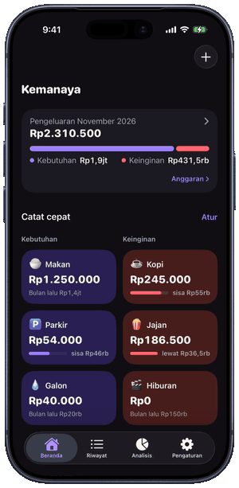
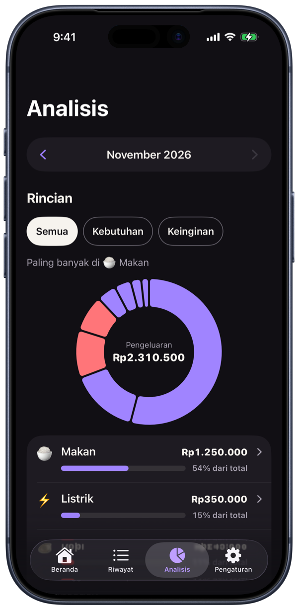
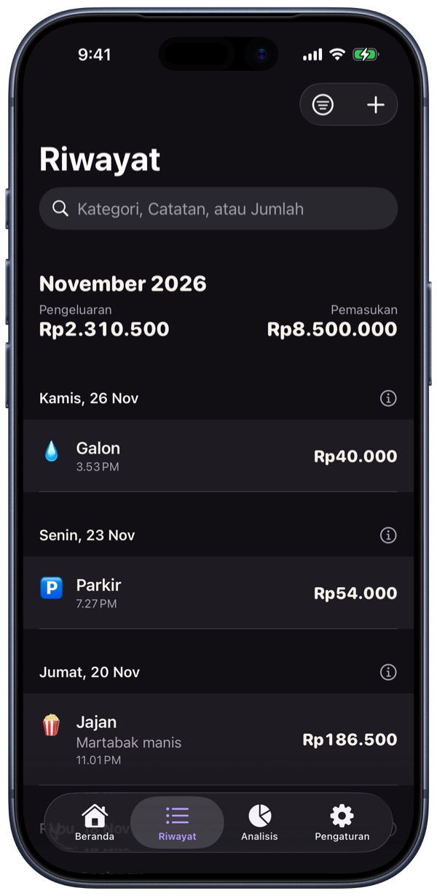
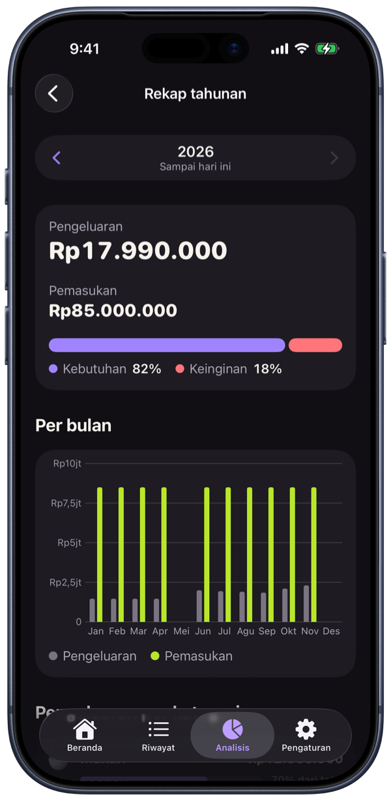

# Kemanaya

A personal iOS app that answers "Kemana ya uangku?" ("where did my money go?"). It tracks expenses, split into **Kebutuhan** (needs) and **Keinginan** (wants), plus income. Pinned subcategory cards on the home screen make logging an expense a few taps, and all data stays on the phone, with backups to a folder you choose.

iPhone · iOS 18.0+ (Liquid Glass on iOS 26+) · personal project

<table>
  <tr>
    <td align="center"></td>
    <td align="center"></td>
    <td align="center"></td>
    <td align="center"></td>
  </tr>
  <tr>
    <td align="center">Log from a pinned card</td>
    <td align="center">Breakdown</td>
    <td align="center">History</td>
    <td align="center">Yearly recap</td>
  </tr>
</table>

Screenshots use built-in sample data.

## Project

- **Fast logging:** pinned subcategory cards in a needs column and a wants column. A tap opens a rupiah keypad with that subcategory already selected, so logging is the amount and Simpan.
- **Month and budgets:** the month's spending with the needs and wants split, and optional budgets for each group and for single subcategories, all set from one Anggaran sheet. Budgets show what is left or over in neutral colours, because the app never celebrates spending.
- **Analisis:** a donut and ranking of the month's subcategories, daily or weekly trend bars, six months of spending and income, and a detail screen per subcategory.
- **History and yearly recap:** 13 months of transactions, grouped by day and searchable by category, note or amount. Older months are rolled up into monthly totals that are kept forever, so the yearly recap stays complete.
- **Backup and settings:** automatic JSON backup to a folder you pick (such as iCloud Drive), restore and CSV export, an onboarding with the Si Naya mascot, Indonesian and English following the iPhone's language, and a light, dark or automatic appearance.

## My role and contributions

Sole developer, product owner and designer. I built Kemanaya with **Claude Code** as an AI coding agent: I made the product and design decisions and reviewed the work, and the agent wrote much of the code.

- Defined the product in [`documents/DECISIONS.md`](documents/DECISIONS.md): 83 numbered decisions, each with its reason, and tracked the work in [`documents/PROGRESS.md`](documents/PROGRESS.md).
- Designed the brand (violet, coral and lime palette with WCAG AA contrast checked by tests, rounded type for amounts, glass only on system chrome), the Si Naya mascot and the app icon.
- Designed the architecture: a local `KemanayaCore` package holds the models and all logic, and the app target holds the views and the design system. No third-party dependencies.
- Built local storage with SwiftData: a versioned schema, money as whole rupiah in `Int64`, and a 13-month window where each older month is rolled up and removed in one save, so no total is lost or counted twice.
- Covered the logic with 450 unit tests, and the main flows with 52 UI tests, including a screenshot tour in light mode, dark mode and the largest text size.
- Tested on iOS 26.5 and on the iOS 18.6 material fallback, in light and dark mode and at large text sizes, and fixed the layouts that broke there.

## Technologies and tools

| Area | Used |
|---|---|
| Language and UI | Swift 6, SwiftUI, Liquid Glass with material fallbacks |
| Apple frameworks | SwiftData, Swift Charts, UIKit, UniformTypeIdentifiers, CoreTransferable, OSLog |
| Data | SwiftData (local only), JSON backup files, CSV export |
| Localization | String Catalogs (Indonesian and English) |
| Testing | Swift Testing (450 tests), XCTest UI tests (52 tests) |
| Tools | Xcode, Xcode MCP, Git, GitHub, Claude Code |

## Run it

1. Open `Kemanaya.xcodeproj` in Xcode 27.1+.
2. Put your team in `Config/Signing.local.xcconfig` (`DEVELOPMENT_TEAM = YOURTEAMID`), and change the bundle IDs to your own.
3. Build to an iPhone running iOS 18+. Run the tests on an iOS simulator with ⌘U: the default Fast plan runs the unit tests, and the Full plan adds the UI tests.
